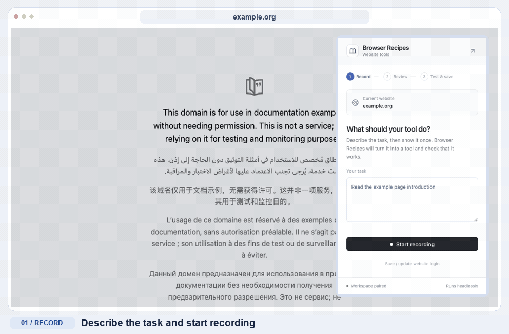

# Browser Recipes

Browser Recipes turns a demonstrated website task into a tool that an MCP client can call. Record the task in a Chromium browser, choose what the tool should return, and review the recipe. Browser Recipes tests it in a local headless browser and saves it after a successful run.



## Quick start

Requires Node.js 22+, pnpm, and a Chromium-based browser for the extension. Install the browser used by the backend separately.

```sh
pnpm setup
pnpm --dir backend exec playwright-core install chromium
pnpm dev
```

1. Open <http://127.0.0.1:5173/install> in your Chromium browser. Download and unzip the extension. Enable Developer mode in the browser's extensions manager and load the folder containing `manifest.json`.
2. Reload the local workspace in that browser to pair the extension. For a smoke test, open <https://example.org/> and describe a simple task such as “Return the page heading.”
3. Start recording, grant access to the demo origin, then finish the recording and select the heading as the output. Choose **Build my tool** and review the test result.
4. In **MCPs**, open the server for that site and use **Connect agent** to copy its local endpoint and access token into your MCP client. Keep the backend running for calls. The recording browser can close.

Model assistance is optional. To enable it, copy `backend/.env.example` to `backend/.env`, fill in your own OpenRouter key, and restart. Task descriptions and action structure go to OpenRouter when configured. Keep credentials and private content out of those descriptions.

## Contribute

- [Frontend and extension development](frontend/README.md)
- [Backend setup and storage](backend/README.md)
- [Implementation handoff](backend/docs/teaching-flow.md)
- [Recipe and API contract](backend/docs/workflow-contract.md)
- [Synthetic recipe example](backend/examples/README.md)

Run `pnpm test` to check the backend, extension, frontend types, and production build. Use controlled fixtures for browser tests. When reporting a problem, include the failing step and a redacted error with a public or synthetic reproduction.

Browser Recipes is a single-user localhost project. Keep both services on loopback. Login portability depends on the website. Replay is scoped to the authorized origin, and mutating requests require approval for the exact recipe. Only tested, saved, unarchived tools are callable on an active MCP.

## License

Browser Recipes is released under the [MIT License](LICENSE). Vendored Arc UI components retain their [upstream MIT notice](frontend/src/components/arc/LICENSE).
